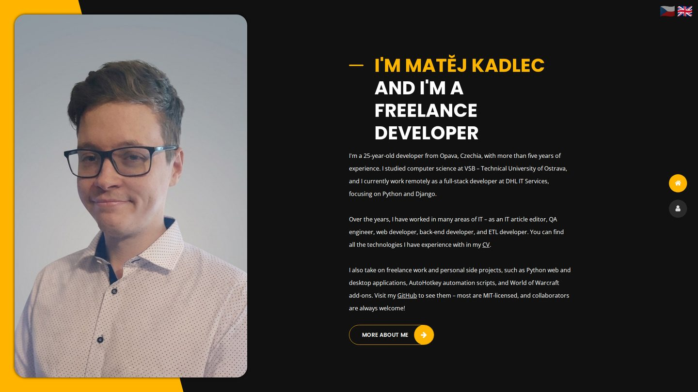

# Matěj Kadlec – Personal Website

The source code of my personal portfolio website,
**[matejkadlec.cz](https://matejkadlec.cz)**. It introduces me as a developer:
my experience, education and skills, the projects I have built, and links to
my CV, GitHub and LinkedIn.

## Features

- **Bilingual (English / Czech)** – every page exists in both languages, so
  search engines index both. Visitors are sent to their browser's language
  (Czech browsers get Czech, everyone else English) and can switch with the
  flags; a manual choice is remembered. The CV download follows the language.
- **Projects page** – featured projects with screenshot galleries and a
  keyboard-friendly lightbox, plus compact cards for smaller projects.
- **Lightweight** – plain HTML, CSS and vanilla JavaScript: no JavaScript
  framework, no build step and about 13 KB of JavaScript.
- **SEO-friendly** – canonical URLs, hreflang links between the language
  versions, Open Graph and X cards, JSON-LD structured data (`Person`,
  `WebSite`, `ProfilePage` with breadcrumbs) and a sitemap.
- **Responsive** – a desktop layout with side navigation and a mobile layout
  with a slide-in menu, plus scroll reveal animations.
- **Accessible** – semantic headings, descriptive alt texts and labelled
  controls.

## Tech stack

- **Markup & styles:** HTML5, CSS3, [Bootstrap 4](https://getbootstrap.com/)
  (grid and utilities), [Font Awesome 4](https://fontawesome.com/v4/)
- **Scripts:** vanilla JavaScript (language redirect and switcher, scroll
  animations, preloader)
- **Fonts:** Poppins and Open Sans from Google Fonts
- **Hosting:** Apache 2.4 – `.htaccess` handles clean URLs, redirects and
  caching

## License

© 2026 Matěj Kadlec. All rights reserved – see [LICENSE](LICENSE).
Third-party files (Bootstrap, Font Awesome and the other vendor files in
`assets/`) remain under their own licenses.
